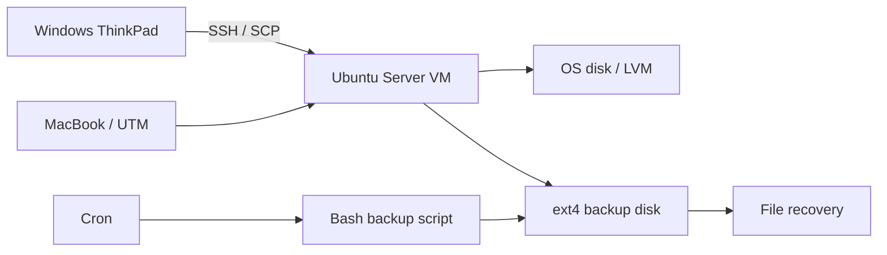

# Home Network Operations Center (HNOC)
## Phase 1 — Linux Server Deployment & Automated Backup Infrastructure

November 27–28, 2026 | Personal home lab | Phase 1 implementation

## Overview
I repurposed an Apple M4 MacBook Air as a dedicated virtual Linux server, managed from a Windows 11 Lenovo ThinkPad. The objective was to establish centralized local storage, remote administration, and scheduled backups as a foundation for future monitoring and security labs.

## Implementation
- Deployed ARM64 Ubuntu Server using UTM and Apple Virtualization after encountering a VMware account-access issue.
- Configured bridged networking with DHCP and SSH remote administration over TCP 22.
- Attached a dedicated virtual backup disk, formatted it with ext4 and configured persistent UUID-based mounting in /etc/fstab at /srv/backups.
- Transferred a test file from Windows using SCP and configured Windows Task Scheduler for noninteractive transfers.
- Implemented timestamped Bash backups with a mount-point check and cron scheduling.

## Architecture

## Configuration recorded in the lab notes
| Component | Recorded configuration |
|---|---|
| VM | ARM64, 4 vCPU, 8 GB RAM |
| OS disk | 80 GB, LVM |
| Backup disk | 20 GB, ext4 |
| Mount | /srv/backups |
| Network | Bridged, DHCP |
| Schedule | Sunday 02:00, server local time |

Exact VM allocations and Ubuntu release still require live configuration verification. Machine-specific network identifiers are omitted from this public document.

## Automation
The backup script checks the dedicated mount using `mountpoint -q /srv/backups`. Timestamped directories preserve multiple versions. Cron was temporarily scheduled every minute to test execution before restoring the weekly schedule. Output and errors are redirected to a log for troubleshooting.

## Validation recorded in the lab walkthrough
| Test | Recorded outcome |
|---|---|
| Server deployment and SSH | Pass |
| Persistent mount after reboot | Pass |
| SCP test transfer and scheduled transfer | Pass |
| Bash backup and timestamped directories | Pass |
| Short-interval cron test | Pass |
| Test file recovery | Pass |
| First unattended weekly run | Pending |

These results are from the project walkthrough, not an independent live audit. Original scripts, task configuration and screenshots are not included until verified.

## Limitations and next steps
Both virtual disks share one physical SSD; this is not protection against host failure. DHCP addressing may change. Backup retention, external redundancy, SSH hardening, and unattended weekly verification remain outstanding. Future phases may include Cockpit, Prometheus, Grafana, Uptime Kuma, Portainer, network segmentation and AWS integration.

## Skills practiced
Linux administration, ARM virtualization, IPv4, SSH/SCP, partitioning, ext4, LVM, Bash, cron, Windows Task Scheduler, backup recovery and troubleshooting. This was a guided, AI-assisted learning project.

## Author
Charles Mibbs — WGU Cloud and Network Engineering, AWS track.
